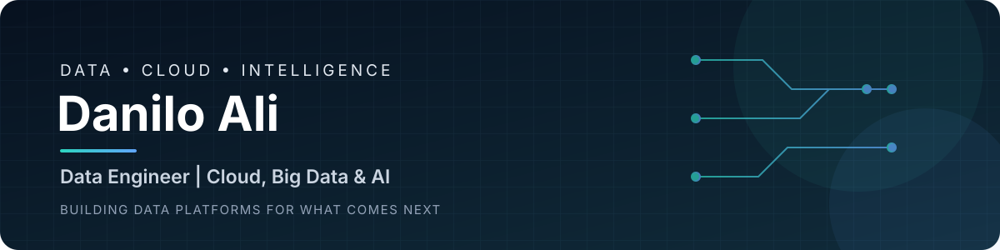

### Data Engineer | Cloud, Big Data & AI

Building scalable data platforms, cloud architectures and intelligent data solutions.

---

## About Me

I'm a **Data Engineer at IBM Consulting**, focused on building reliable data pipelines and cloud-based data solutions.

My work and technical interests span **ETL/ELT engineering, data architecture, cloud platforms, orchestration, data modeling and analytics**. I enjoy connecting software engineering practices with data platforms to create solutions that are scalable, maintainable and useful to the business.

I've worked with services and tools across **AWS, Google Cloud Platform and Microsoft Azure**, while continuously expanding my knowledge of distributed data processing, modern lakehouse architectures and the evolving **Data & AI Engineering** landscape.

I'm currently exploring the **Microsoft Fabric ecosystem**, including Power BI, OneLake Catalog and Capacity Metrics, while strengthening my foundations in Spark, PySpark and AI-ready data infrastructure.

`DATA ENGINEERING` → `CLOUD & BIG DATA` → `ANALYTICS` → `DATA & AI`

---

## GitHub at a Glance

Public commit count covers the last 12 months. Profile views are counted from the moment the external counter is added.

---

## Engineering Focus

<table>
<tr>
<td width="50%" valign="top">

### Data Engineering

- ETL / ELT Pipelines
- Data Lake & Lakehouse
- Medallion Architecture
- Data Warehousing
- Data Integration
- Data Modeling
- Data Quality & Governance
- Workflow Orchestration

</td>
<td width="50%" valign="top">

### Cloud & Infrastructure

- Amazon Web Services
- Google Cloud Platform
- Microsoft Azure
- Microsoft Fabric
- Serverless Architecture
- Object Storage
- Infrastructure as Code
- Containerization

</td>
</tr>
<tr>
<td width="50%" valign="top">

### Big Data & Distributed Systems

- Apache Spark
- PySpark
- Apache Hive
- Hadoop Distributed File System
- MinIO Object Storage
- Distributed Data Processing

</td>
<td width="50%" valign="top">

### Analytics & Business Intelligence

- Power BI
- Google Looker
- Metabase
- Microsoft Fabric Analytics
- OneLake Catalog
- Capacity Metrics
- Data Visualization

</td>
</tr>
<tr>
<td width="50%" valign="top">

### Programming & Databases

- Python
- SQL
- IBM Db2
- PostgreSQL
- MySQL
- SQL Server
- MongoDB

</td>
<td width="50%" valign="top">

### Data & AI — Learning Path

- Machine Learning Engineering
- AI Data Pipelines
- Feature Engineering
- Vector Databases
- LLM Data Infrastructure
- MLOps
- RAG Architectures

</td>
</tr>
</table>

---

## Technology Stack

### Cloud Platforms

### Programming, Data & Infrastructure

### Development Tools

### Data Platforms & Databases

### Analytics & Business Intelligence

### Data Modeling & Database Tools

---

## Core Technologies

| Category | Technologies |
|---|---|
| AWS | S3, Lambda, Glue, Step Functions, Athena, EventBridge, IAM, KMS |
| Google Cloud | BigQuery, Dataform, Cloud Storage, Cloud Composer, Cloud Functions, Cloud Run |
| Microsoft Azure | Azure Functions, Blob Storage, PostgreSQL Flexible Server |
| Microsoft Fabric | Power BI, OneLake, OneLake Catalog, Capacity Metrics |
| Big Data | Apache Spark, PySpark, Apache Hive, HDFS, MinIO |
| Databases | IBM Db2, PostgreSQL, MySQL, SQL Server, MongoDB |
| Orchestration | Apache Airflow, Cloud Composer, AWS Step Functions |
| BI & Analytics | Power BI, Google Looker, Metabase |
| Data Modeling | Erwin Data Modeler, Dimensional Modeling |
| Programming | Python, SQL |
| Infrastructure | Docker, Terraform, Git, Linux |

---

## Current Focus — Microsoft Fabric & Data Analytics

Exploring the Microsoft Fabric ecosystem, with particular interest in enterprise analytics, data discovery, governance and capacity optimization.

- **Power BI:** Enterprise reporting, dashboards and data visualization.
- **OneLake Catalog:** Data discovery, catalog exploration and data organization.
- **Capacity Metrics:** Monitoring and analyzing Fabric capacity utilization.
- **Enterprise Analytics:** BI environments, workload management and analytics optimization.

Alongside this, I'm developing my knowledge of **Spark, PySpark and AI-oriented data architectures**.

---

## Certifications

---

## Explore My Work

I use GitHub to document technical experiments, hands-on labs and projects involving data engineering, cloud infrastructure, automation and analytics.

---

### Building today. Engineering tomorrow.

*Driven by data, powered by technology, inspired by AI.*

